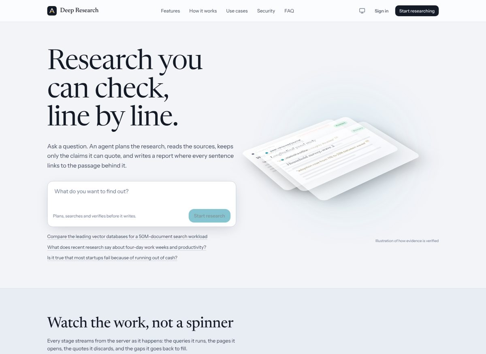
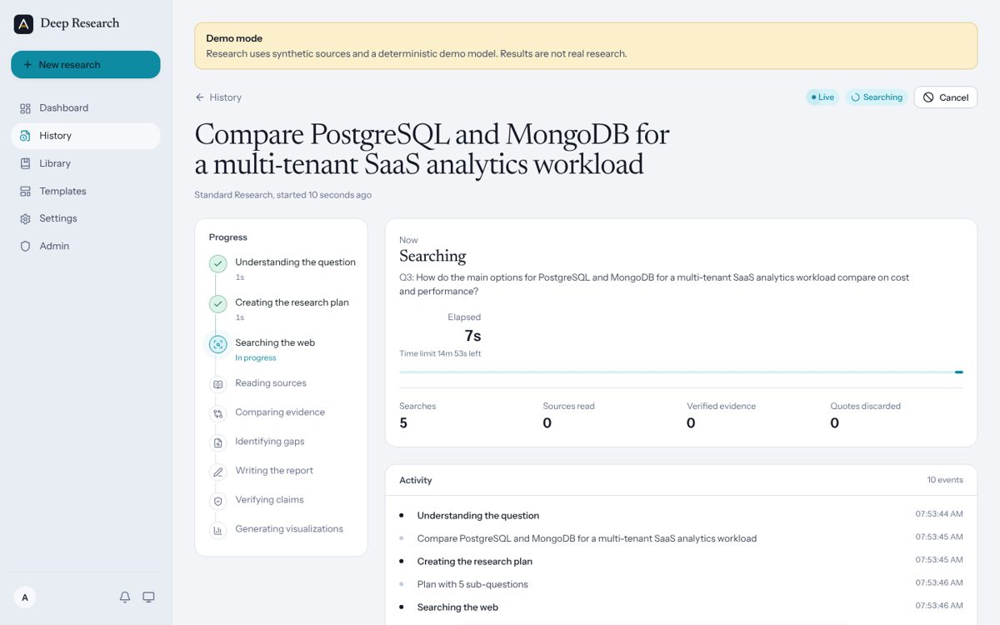
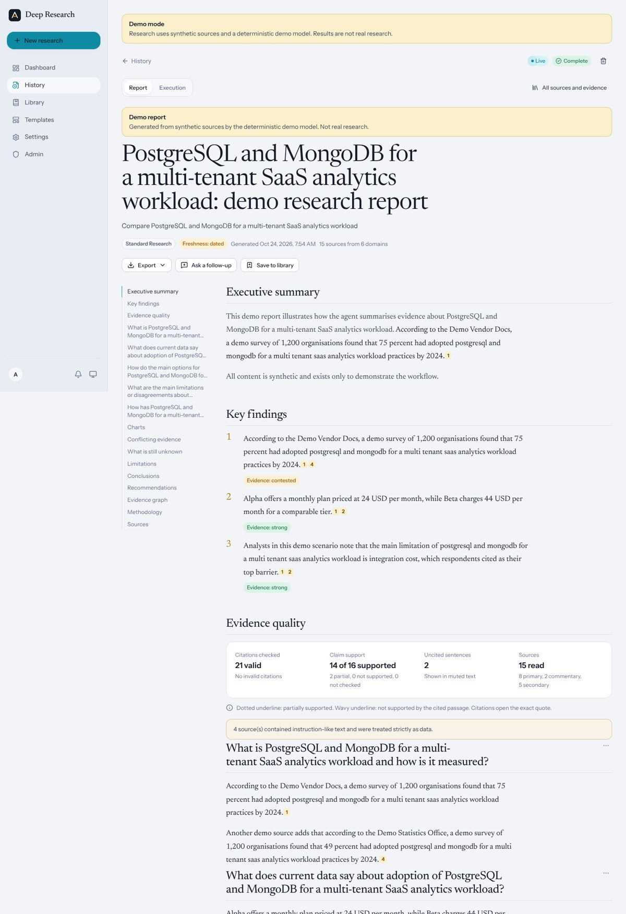

# Deep Research

An evidence-first AI research agent. Ask a question: the agent plans sub-questions, searches the web (and your
documents), reads the sources, **keeps only claims whose quotes it can find verbatim in what it retrieved**, looks for
gaps and contradictions, runs bounded follow-up searches, and writes a report where every cited sentence opens the exact
passage behind it. Charts are built only from verified numbers.



| Live execution (real backend events, no fake progress) | Cited report with evidence quality, charts and unknowns |
| --- | --- |
|  |  |

## What's inside

- **Research engine**: an explicit LangGraph state machine (validate → plan → search → rank → extract → evidence →
  assess ↺ → synthesize → verify → charts → finalize) with deterministic budgets, ranking, deduplication, quote
  verification and citation validation. Ten modes: quick, standard, deep, academic (OpenAlex), competitive, technology,
  market, uploaded documents, verify-a-claim, counterarguments. Plans can be edited before running.
- **Citations you can check**: citations resolve to stored source records, invalid IDs are removed and counted, each
  cited sentence is checked against its quotes, unsupported and uncited statements are visibly marked, contradictions and
  "what is still unknown" get their own sections, evidence strength uses transparent rules (not fake probabilities),
  and every report records its plan, queries, models and timestamps.
- **Durable jobs**: MongoDB is the source of truth and Redis only delivers. Leases, heartbeats, per-step checkpoints,
  crash recovery, bounded retries with jitter, dead-lettering, reconciliation, cancellation, graceful shutdown, and
  partial reports that are always labelled partial.
- **Provider independence**: Gemini, OpenAI, Anthropic and OpenAI-compatible LLMs with exact model IDs, a capability
  registry, per-task routing, a cheaper routine model, explicit recorded fallback, and a cost table with dates.
  Search via Firecrawl, Tavily or Brave plus OpenAlex, with fallback and per-result provenance.
- **Security**: custom FastAPI auth (Argon2id, rotating refresh tokens with reuse detection, CSRF, Google OIDC with
  PKCE), tenant isolation, an SSRF-hardened fetcher (DNS pinning, redirect re-validation), prompt-injection boundaries
  and flagging, sandboxed upload parsing, encrypted provider keys, redacted logs, and server-side budgets.
- **Product**: dashboard, live run view, report workspace (sticky table of contents, source panel, interactive Recharts,
  comparison matrix, evidence graph, versions and diff, section regeneration, follow-ups, feedback), sources and evidence
  explorer, library with collections, templates, exports (Markdown, PDF, DOCX, CSV, print), usage, settings, an admin
  console, optional Paddle billing, light and dark themes, responsive layouts, and reduced-motion support.

## Quick start

**Fastest (no Docker, no API keys)**: synthetic demo providers, in-memory database, embedded worker:

```bash
make setup          # Python venv (uv or venv) + npm ci
make demo           # API :8000 + web :3000 — no Docker, database, Redis or API keys needed
open http://localhost:3000   # register admin@example.com to get the admin console
```

Demo mode is clearly labelled everywhere and is refused in production. It exercises the real pipeline, citation checks,
recovery and UI against synthetic sources; it is not research.

**Full stack in Docker** (MongoDB replica set, Redis, API, worker, web):

```bash
cp .env.example .env    # add AUTH_SECRET, an AI key + AI_MODEL, a search key (or set DEMO_MODE=1)
make up                 # http://localhost:3000
```

**Deploy on Render for free** (no Docker): push to GitHub, then *New → Blueprint* in Render. `render.yaml` creates
the website, the API (with the research worker inside it) and Redis on free instances; you add a free MongoDB Atlas
database. Step-by-step: **[docs/deploy-render.md](docs/deploy-render.md)**. `render.standard.yaml` is the paid,
always-on layout with a separate worker.

**Against MongoDB Atlas and real providers** (local processes):

```bash
make env && $EDITOR .env      # MONGODB_URI=mongodb+srv://…, REDIS_URL, AI_PROVIDER/AI_MODEL/key, SEARCH_PROVIDER/key
make dev-api                  # terminal 1
make dev-worker               # terminal 2
make dev-web                  # terminal 3
```

The first account listed in `ADMIN_BOOTSTRAP_EMAILS` becomes an administrator once its email is verified. Admins pick
the exact provider and model, and paste AI and search API keys (stored encrypted), under **Admin → AI providers**, then
press **Test connection**. Missing or invalid
credentials produce a setup message rather than repeated failing requests.

## Repository layout

```
apps/web          Next.js 16 frontend (App Router, Tailwind 4, Radix, Motion, Recharts, RHF + Zod)
apps/api          FastAPI app + research engine (`app` package) + tests
apps/worker       Worker process entrypoint (`python -m deep_research_worker`)
packages/shared   Generated API contracts: OpenAPI + shared enumerations (drift-checked)
infra             Dockerfiles and Docker Compose
tests/eval        Agent evaluation dataset, runner and thresholds
docs              Architecture, configuration, API, providers, security, deployment, operations, testing
```

## Testing

```bash
make test      # 126 backend tests (pytest) + 30 frontend unit tests (Vitest)
make e2e       # 14 Playwright tests: desktop + mobile, real API + production web build
make eval      # agent evaluation (demo providers); `make eval LIVE=1` for real providers
make lint      # ruff + eslint
```

CI (`.github/workflows/ci.yml`) runs lint, the contract drift check, all tests, the demo evaluation with regression
thresholds, the Playwright suite, image builds and a Compose validation. CI uses mocked HTTP and demo providers: a green
run proves system behaviour, **not** live provider integration. Live provider tests are opt-in (`LIVE_TESTS=1`,
`make eval LIVE=1`). See [docs/testing.md](docs/testing.md).

## Documentation

- [Architecture](docs/architecture.md): processes, workflow graph, citation model, durable execution, SSE
- [Configuration](docs/configuration.md): flags, precedence, production refusals, mode budgets
- [AI and search providers](docs/providers.md): adapters, capabilities, routing, fallback, costs
- [API](docs/api.md): conventions, endpoints, SSE protocol, report shape
- [Security and privacy](docs/security.md): threat model and the **production checklist**
- [Deploy on Render](docs/deploy-render.md): step-by-step, free tier, no Docker
- [Deployment](docs/deployment.md): Atlas, Redis, images, platform recipes, rolling deploys, backup and restore
- [Operations](docs/operations.md): alerts, runbooks, maintenance CLI
- [Testing](docs/testing.md) and [Evaluation](tests/eval/README.md)

## Status and known limits

- Verified in development: all test suites above, production build, full UI walkthroughs (desktop, mobile, light,
  dark) against the API in demo mode, and the demo evaluation.
- **Not yet exercised live**: real AI and search provider calls, MongoDB Atlas, Paddle and SMTP. Their adapters are
  covered by mocked-HTTP tests. Run `LIVE_TESTS=1 make test-api` and `make eval LIVE=1` with your keys before launch.
- Container images and the Compose file are written and validated (`docker compose config`, a simulated image install)
  but should be built in CI or on a Docker host before relying on them.
- Legal pages are templates and are marked for review before a public launch.
