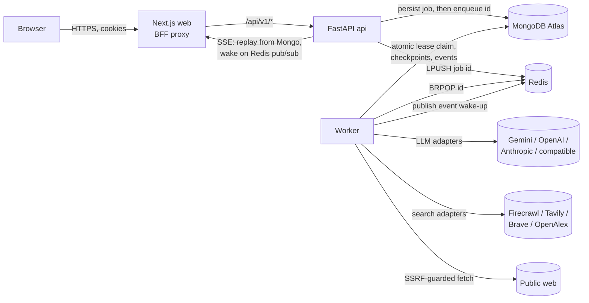
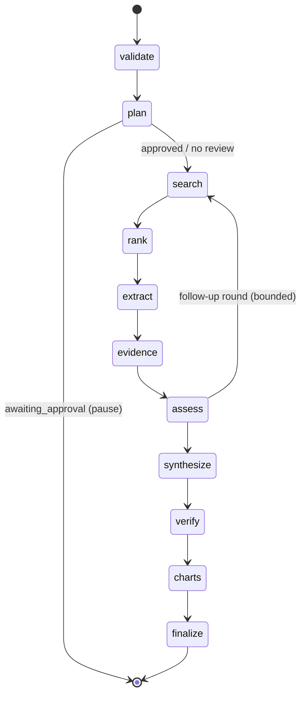

# Architecture

Deep Research is a **modular monolith** with three deployable processes:

| Process | Code | Responsibility |
| --- | --- | --- |
| **web** | `apps/web` (Next.js 16, App Router) | UI. A same-origin backend-for-frontend proxy (`app/api/v1/[...path]/route.ts`) forwards `/api/v1/*` to FastAPI so session cookies stay HttpOnly and first-party. It holds no secrets and makes no authorization decisions. |
| **api** | `apps/api` (FastAPI, Pydantic v2) | Authentication, authorization, configuration, job acceptance, reports, exports, SSE, admin, billing webhooks. |
| **worker** | `apps/worker` → `app.jobs.worker` | Executes research, section-regeneration and export jobs. Same `app` package as the API, so job semantics cannot drift. |

Backing services: **MongoDB Atlas** (durable source of truth) and **Redis** (queue delivery, rate limits, pub/sub
wake-ups for SSE, search cache). The browser never talks to AI or search providers.



## Module map (`apps/api/app`)

| Package | Contents |
| --- | --- |
| `core/` | Typed settings with startup validation (`config.py`), errors and the error envelope, structured logging with redaction and correlation IDs, rate limiting, crypto (Argon2id, JWT, AES-GCM), error-tracking hook. |
| `auth/` | Email/password, sessions with rotating refresh tokens, CSRF, Google OIDC (PKCE, state, nonce), dependencies (`current_principal`, `require_admin`, `require_feature`). |
| `db/` | Mongo connection, collection registry, indexes, schema validators, TTL indexes. Redis connection. |
| `llm/` | Provider protocol, adapters, capability registry, config store (encrypted keys), `AIService` (task routing, budgets, fallback, usage and cost accounting), demo provider. |
| `search/` | Search and extraction protocol, adapters, URL canonicalization, `SearchService` (fallback, cache, budgets), demo provider. |
| `research/` | LangGraph pipeline, prompts, schemas, evidence verification, citation resolver, charts, reports, mode budgets, `JobContext`. |
| `jobs/` | Queue, lease lifecycle, worker. |
| `security/` | SSRF-safe fetching, prompt-injection detection and data boundaries. |
| `extract/` | Sandboxed document parsers (subprocess with CPU, memory and file limits). |
| `services/` | Accounts (export, delete), limits and entitlements, exports (Markdown, PDF, DOCX, CSV), mailer, audit log. |
| `api/` | Routers: research, uploads, user, admin, billing, system. |
| `contracts.py` | Generates `packages/shared` (OpenAPI and enumerations). |

## Research workflow

The workflow is an explicit LangGraph state machine (`research/pipeline.py`). It is not an open-ended agent loop.



| Node | LLM? | What it does |
| --- | --- | --- |
| `validate` | yes (routine model) | Classifies the question, notes ambiguities and assumptions, runs an optional safety check (`CONTENT_SAFETY_ENABLED`). |
| `plan` | yes | Produces sub-questions, search queries, entities and comparison attributes. Optionally pauses for the user to edit and approve. |
| `search` | no | Runs the planned queries within the search budget, merges duplicates by canonical URL, and records which provider produced each hit. |
| `rank` | no | Applies domain and date filters, scores candidates, round-robins across sub-questions, caps sources per registrable domain for diversity, and records every rejection with its reason. |
| `extract` | no | Fetches page text (provider extraction or SSRF-safe fetch), uploads or prior-report sources. Scans for injection. Inaccessible sources are marked as such and never "verified". |
| `evidence` | yes | Reads passages and returns claims and datapoints, each with an exact **quote**. `verify_quote` checks the quote against the retrieved text deterministically (exact, normalized, then fuzzy within strict bounds). Unverifiable quotes are discarded and counted. Datapoints also require the number to appear in the quote. |
| `assess` | yes | Gap and contradiction analysis over the evidence ledger. Schedules targeted follow-up queries only if iteration, search, time and token budgets allow. |
| `synthesize` | yes | Writes the report citing **evidence IDs** (`[E12]`). `CitationResolver` keeps only IDs that exist in stored, verified evidence, maps them to source numbers, removes invalid markers, ignores stray `[3]`-style markers, and marks uncited sentences. |
| `verify` | yes | Checks cited sentences against their quotes (`supported`, `partially_supported`, `not_supported`). Assigns rule-based evidence-strength labels to key findings. |
| `charts` | no | Builds charts only from verified datapoints (every point carries `evidence_id` and source) plus process charts (source types, publication years, evidence per sub-question). |
| `finalize` | partly | Publishes a versioned report with methodology, freshness, source stats and warnings. |

**Bounds.** Every node checks `JobContext.check_alive()` (cancellation, lease, deadline). Budgets are per mode
(`research/modes.py`) and capped by global `MAX_*` settings: search calls, sources, tool calls, output tokens,
estimated cost, duration and follow-up iterations. Writing reserves are held back so a run that hits its budget still
produces a (partial) report. LangGraph's `recursion_limit` is a final backstop.

**Modes.** quick, standard, deep, academic (OpenAlex plus web, abstracts labelled), competitive / technology / market
(comparison matrix), documents (uploads only, no web), verify_claim, counterarguments. Follow-ups reuse a parent report's
sources.

## Evidence and citation model

```
research_sources   one per selected URL/upload: canonical_url, title, publisher, author, published_at,
                   retrieved_at, status (candidate|extracted|inaccessible), source_type (primary|secondary|commentary),
                   injection_flags, content_kind (full_text|abstract)
source_contents    extracted text (separate collection, bounded size) + sha256 content hash
research_evidence  E-numbered claims/datapoints: quote, verified, match_method, stance, subquestion, source ref
research_reports   immutable versions; paragraphs → segments {text, evidence_ids, sources, support, support_note}
```

The UI renders a citation chip only for a segment's resolved `sources`. Clicking it opens the source panel with the
verified passages for exactly those evidence IDs. "Evidence strength" is a transparent rule over independent domains,
primary sources and contradictions. It is **not** a probability (`STRENGTH_CRITERIA` is shipped with every report).

## Durable execution

- **Accept**: `POST /research` validates, checks limits and entitlements, and refuses with `503 queue_unavailable` if
  Redis is down, so nothing is accepted that cannot be dispatched. It then **inserts the job in Mongo** (durable
  acceptance) and pushes the ID to Redis. If that push fails after the insert, the reconciler dispatches the job from
  Mongo. An `Idempotency-Key` header dedupes retries of the same request (unique index on `user_id` + key).
- **Claim**: `find_one_and_update` on runnable jobs (queued, waiting_for_retry with `next_attempt_at` due, or active
  with an expired lease) sets `lease {owner, token, expires_at}` and increments `run_count`.
- **Heartbeat** every `WORKER_HEARTBEAT_SECONDS` extends the lease. All job writes are conditioned on `lease.token`,
  so a worker that lost its lease cannot clobber the new owner.
- **Checkpoint** after each node and inside long nodes (per query, per source, per evidence batch). Resume continues
  from `checkpoint.next` and emits a `recovery` event.
- **Retry**: transient errors (`rate_limited`, `timeout`, `provider_unavailable`, DB blips, unexpected exceptions) back off
  exponentially with jitter up to `MAX_JOB_ATTEMPTS`, then dead-letter (`dr:queue:dead`) with a partial report.
  `invalid_credentials`, `quota_exhausted`, `billing_exhausted`, `not_configured`, `model_not_found`,
  `unsupported_capability` and `context_overflow` errors (after any configured fallback) fail
  immediately as **resumable**: fix the configuration, then press Resume.
- **Reconcile** every few seconds: re-enqueue runnable jobs whose delivery was lost and finalize cancellations of idle
  jobs.
- **Cancel** sets `cancel_requested`. The running worker sees it at the next check, writes a partial report and marks
  the job `cancelled`.
- **Shutdown**: SIGTERM stops claiming, gives in-flight steps up to 20 s to checkpoint, then releases leases and
  re-enqueues.
- **Pause**: plan review persists state and sets `awaiting_approval`. The deadline clock stops while paused.

Statuses: `queued → planning → searching → extracting → verifying → synthesizing → completed`, plus `waiting_for_retry`,
`awaiting_approval`, `failed`, `cancelled`. A partial report is always labelled `partial` with its reason.

## Live progress (SSE)

Events are appended to `job_events` with a per-job monotonic `seq` (atomic `$inc` on the job). `GET
/research/{id}/stream` replays events after `Last-Event-ID` (or `?after=`), then waits on Redis pub/sub wake-ups with
a periodic Mongo poll as a safety net, and sends keep-alives. The client (`lib/hooks.ts`) reconnects with backoff from
the last seen ID, falls back to polling `GET /research/{id}/events?after=`, shows its connection state, and re-syncs
the job document after reconnecting. Events are what the backend actually did; the UI never fabricates progress, and the
progress bar is indeterminate.

## Provider abstraction

`LLMProvider` (generate, stream, list_models) is implemented for Gemini, OpenAI, Anthropic, OpenAI-compatible and demo,
over raw `httpx` with normalized errors (`ErrorKind`) and bounded retries that honour `Retry-After`. `AIService.structured()`
uses native JSON schema where the capability registry says it is supported, a forced tool call for Anthropic, and
prompt-plus-validation (with one repair attempt) otherwise. Task routing: `planning`, `extraction`, `verification`,
`synthesis`, `charts`, `routine` each map to a configured model, or else the default or cheaper model. Fallback only uses
the explicitly configured fallback model, only when `AI_FALLBACK_ENABLED=1`, only when the primary cannot serve the call
(outage, quota, credentials, missing model), and is recorded on the job and shown to the user. Search providers are independent of the LLM choice. See [providers.md](providers.md).

## Data model

Collections (all owner-scoped by `user_id`; every repository query filters on it):
`users, sessions, verification_tokens, password_reset_tokens, oauth_states, research_jobs, job_events,
research_sources, source_contents, research_evidence, research_reports, agent_runs, research_templates, usage_records,
subscriptions, billing_events, audit_logs, notifications, user_api_credentials, app_settings, uploads, upload_chunks,
library_collections, library_items, feedback, exports`.

Indexes and `$jsonSchema` validators are created idempotently at startup (`db/mongo.py:ensure_indexes`, or
`python -m app.cli init-db`). TTL indexes expire verification/reset tokens, OAuth state, sessions and generated export files; TTL deletion is
asynchronous, so expiry is also checked in code. Large text lives in `source_contents` and `upload_chunks`, never inside
job documents. Event history and error history are bounded.
